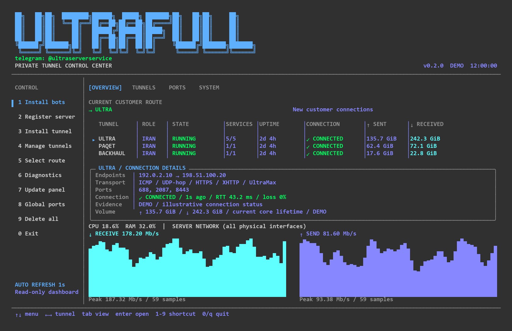

<p align="center">
  
</p>

<p align="center">
  <strong>Version 0.2.6</strong> · Linux amd64 · systemd
</p>

<p align="center">
  <a href="#english">English</a> · <a href="#فارسی">فارسی</a> ·
  <a href="docs/README.md">Installation guide</a>
</p>

## English

ULTRAFULL brings **Ultra, Paqet, Backhaul and Spoof** into one terminal panel. Install tunnels, manage customer ports, select routes and check connection status from the same interface.

Coordinated TCP / ICMP engine selection is available for UltraMax. IP changes preserve the selected engine.

| Component | What it does |
| --- | --- |
| **Ultra** | ICMP, UDP-hop, HTTPS, XHTTP and UltraMax transport choices |
| **Paqet & Backhaul** | Additional tunnel options managed from the same panel |
| **Spoof** | Separate TUN/IPX/TCP family with scoped firewall and verified two-way source identities |
| **ultrasource** | Registers named server pairs and their control bots |
| **tunnelcheck** | Checks tunnels and applies carrier IP changes |
| **configuptime** | Monitors a real customer config and reports outages |

The three Telegram bots run on **your Iran server**, using your own tokens and SSH key.

### Panel overview · صفحهٔ اصلی پنل



*Version 0.2.0 · Illustrative status and traffic data*

*نمای نسخهٔ 0.2.0 با وضعیت اتصال، حجم و سرعت نمایشی.*

### Quick start

Use a fresh **Ubuntu 22.04+** or **Debian 12+** amd64 server with systemd. If you use a customer panel, install it first. Run on both Iran and Foreign:

```bash
curl -fL --proto '=https' --tlsv1.2 \
  https://ultraradar.ultranec.pro:9448/install-commercial.sh -o install-commercial.sh
sudo bash install-commercial.sh
```

First choose **GitHub token / owner** or **License**. Your existing repository token is entered once and saved root-only after verification. License mode keeps the existing Iran / Foreign activation flow and reuses saved activation. Iran activation asks only for the license and verifies its assigned server IP. A license covers **one Iran IPv4**, with **no limit on foreign servers** connected to that entitlement. You can install the foreign side first.

After installation, open the panel with `sudo ultrafull`. Start with **Install bots** on Iran, then follow the [installation guide](docs/README.md#english) for proxy setup, SSH registration and adding a server pair.

<div dir="rtl">

## فارسی

ULTRAFULL پنلی برای مدیریت **Ultra، Paqet، Backhaul و Spoof** است. نصب تونل‌ها، تنظیم پورت‌ها، انتخاب مسیر و بررسی وضعیت اتصال از طریق این پنل انجام می‌شود.

این مجموعه شامل سه ربات تلگرام است:

- ربات **ultrasource**: ثبت جفت‌سرورها با نام دلخواه و مدیریت ربات کنترل هر جفت.
- ربات **tunnelcheck**: بررسی وضعیت تونل‌ها و تغییر آی‌پی هر مسیر.
- ربات **configuptime**: بررسی اتصال واقعی کانفیگ مشتری و گزارش قطعی‌ها.

نصب و اجرای هر سه ربات روی **سرور ایران خودتان** انجام می‌شود. توکن‌ها و کلید SSH نیز متعلق به شما هستند.

### نصب و راه‌اندازی

در صورت نیاز به پنل مدیریت کاربران، ابتدا آن را نصب کنید. سپس دستورهای بالا را روی هر دو سرور اجرا و نقش ایران یا خارج را انتخاب کنید.

لایسنس برای **یک آی‌پی ایران** صادر می‌شود و تعداد سرورهای خارج محدود نیست. نصب سرور خارج پیش از سرور ایران نیز امکان‌پذیر است.

پس از نصب، دستور `sudo ultrafull` را برای ورود به پنل اجرا کنید. روی سرور ایران، از گزینهٔ **Install bots** شروع کنید. مراحل تنظیم پروکسی، وارد کردن توکن‌ها، ثبت کلید SSH و افزودن جفت‌سرور در [راهنمای نصب](docs/README.md#فارسی) توضیح داده شده است.

برای پایش قطعی‌ها، یک کانفیگ معتبر از پنل اصلی کاربران ارائه کنید. وضعیت اتصال مشتریان با همین کانفیگ بررسی می‌شود. کانفیگ مورد استفاده برای اتصال ربات‌ها به تلگرام به‌صورت جداگانه دریافت می‌شود.

</div>

## Documentation

| Guide | Link |
| --- | --- |
| Installation & usage · راهنمای نصب و استفاده | [English / فارسی](docs/README.md) |
| Component licenses and notices | [Third-party notices](docs/THIRD_PARTY.md) |

The commercial installer is separate from the classic edition. Component licenses, including those for open-source software and Backhaul Premium, still apply.


Opening an installed panel with `sudo ultrafull` uses local files; it does not fetch GitHub. Explicit updates and missing-package downloads need network access. License validation uses its cached signed lease and retains its existing expiry and renewal rules.

For Spoof installation, Iran asks whether the VPS is on your own hypervisor. Owned VMs use a one-time pinned SSH registration and a key restricted to that VM; rented VPSs skip the host. Provider source filtering cannot be opened from inside the guest.

This repository contains the public documentation, panel preview and installation bootstrap. Runtime packages are supplied by the license service after validation.

[Protected runtime and update compatibility](docs/PROTECTION.md)
